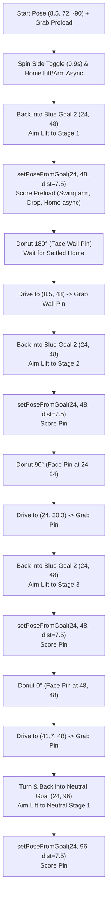

# AI Agent Guidelines & Repository Reference

> [!NOTE]
> **AI AGENT COMMIT & PUSH GUIDELINE:**
> Do **NOT** automatically commit and push after every minor edit or incremental step during rapid testing. Instead, keep changes in the working tree during iteration and only commit & push after completing a major milestone, at the end of a long working session, or when explicitly requested by the user. Always verify the build (`pros make`) beforehand.

---

## 1. Coordinate System & Field Conventions

Every autonomous routine, motion command, and localization algorithm in this codebase follows a unified field coordinate system defined in [`include/constants/field_constants.hpp`](file:///Users/royboy/Library/CloudStorage/OneDrive-TaipeiAmericanSchool/Roy's universe/VEX/Crimson/include/constants/field_constants.hpp) and implemented through the custom chassis wrapper in [`include/motion/chassis.hpp`](file:///Users/royboy/Library/CloudStorage/OneDrive-TaipeiAmericanSchool/Roy's universe/VEX/Crimson/include/motion/chassis.hpp).

### 1.1 Field Origin and Axes
The coordinate system is identical to FRC's Blue Origin convention:
- **Field Size:** $144\text{ in} \times 144\text{ in}$ ($6 \times 6$ tiles, $24\text{ in}$ per tile).
- **Origin `(0, 0)`:** Corner tile corner on the **Blue Alliance's right** when standing behind the blue wall facing Red.
- **`+X` Axis:** Extends from the Blue Alliance wall to the Red Alliance wall ($0 \to 144\text{ in}$).
- **`+Y` Axis:** Extends along the Blue Alliance wall to Blue's left ($0 \to 144\text{ in}$).
- **Center of Field:** `(72, 72)`.

```
                +Y (Blue Alliance Left)
        (0, 144) ----------------------- (144, 144)
                 |                     |
                 |      Neutral        |
    BLUE WALL    |       (72,72)       |   RED WALL
       (+Y)      |                     |      (+X)
                 |                     |
          (0, 0) ----------------------- (144, 0)
         Origin           +X (Facing Red)
```

### 1.2 Heading & Rotation
- **Heading 0°:** Points directly along `+X` (facing the Red Alliance wall).
- **Rotation Direction:** **Clockwise positive** (to match LemLib and standard compass conventions).
  - `0°`: Facing `+X` (Red wall)
  - `90°`: Facing `-Y` (Blue's right)
  - `180°` / `-180°`: Facing `-X` (Blue wall)
  - `270°` / `-90°`: Facing `+Y` (Blue's left)

### 1.3 Field Frame vs. LemLib Native Frame
LemLib’s native coordinate system assumes heading $0^\circ$ points along its $+Y$ axis.
To eliminate confusion, **`crimson::Chassis` transparently converts between Field coordinates and LemLib coordinates**:
- LemLib coordinates: $x_{\text{lemlib}} = -y_{\text{field}}$, $y_{\text{lemlib}} = x_{\text{field}}$.
- Heading values are numerically identical in both systems.
- **Rule for Autons:** Auton scripts (`src/autons/`) **ALWAYS** write and receive coordinates in the **Field frame** inches `(x, y)`. The wrapper handles all conversions internally.

### 1.4 Field Symmetry & Transformations
The field possesses **180° point rotational symmetry** around the center `(72, 72)`.
Any routine designed on the Blue side can be transformed to the Red side via:
$$x_{\text{red}} = 144 - x_{\text{blue}}, \quad y_{\text{red}} = 144 - y_{\text{blue}}, \quad \theta_{\text{red}} = \theta_{\text{blue}} + 180^\circ$$

### 1.5 Goal Positions & Heights (from `field_constants.hpp`)
All mobile goals are placed on the $24\text{ in}$ tile grid:

| Goal ID | Position $(X, Y)$ (in) | Alliance / Type | Tag ID | Tag Height (mm) |
| :--- | :--- | :--- | :---: | :---: |
| `Center` | `(72, 72)` | Neutral | 0 | 178.0 |
| `Neutral1Far` | `(120, 48)` | Neutral | 1 | 101.8 |
| `Neutral1Near`| `(24, 96)` | Neutral | 1 | 101.8 |
| `Neutral4Far` | `(96, 24)` | Neutral | 4 | 101.8 |
| `Neutral4Near`| `(48, 120)` | Neutral | 4 | 101.8 |
| `Red2` | `(120, 96)` | Red | 2 | 37.8 |
| `Red3` | `(96, 120)` | Red | 3 | 37.8 |
| `Blue2` | `(24, 48)` | Blue | 2 | 37.8 |
| `Blue3` | `(48, 24)` | Blue | 3 | 37.8 |

---

## 2. Autonomous Routine: "Snacky" (`src/autons/match/snacky.cpp`)

[`src/autons/match/snacky.cpp`](file:///Users/royboy/Library/CloudStorage/OneDrive-TaipeiAmericanSchool/Roy's universe/VEX/Crimson/src/autons/match/snacky.cpp) is the primary Blue match autonomous routine. It adapts moves around Blue Goal 2 `(24, 48)` based on the Skills routine mirrored 180° around field center.

### 2.1 Routine Setup & Initial Pose
- **Starting Pose:** `chassis.setPose(8.5, 72, -90)`
  - Located on the Blue Alliance wall at $Y = 72\text{ in}$ (field centerline), facing $-90^\circ$ ($+Y$ direction).
  - Claw grips preload ring: `claw::grab()`.

### 2.2 Sequence of Operations



### 2.3 Detailed Step Breakdown
1. **Initialization:**
   - Preload held: `claw::grab()`.
   - Side toggle motors spun 8 relative turns: `side_toggle_motors.move_relative(-8 * 360.0, 200)`.
   - Asynchronously home the arm and elevator against hardstops: `macros::home_async()`.
2. **Preload Score on Blue Goal 2 `(24, 48)`:**
   - Reverse drive: `chassis.moveToPoint(24, 48, 950, {.forwards = false})`.
   - Pre-raise lift for Stage 1: `macros::aim_lift(stage(1))`.
   - Physical goal reset: `chassis.setPoseFromGoal(24, 48, {.distance = 7.5})`.
   - Score sequence (`score()`): Swing chain bar arm, drop ring, async home.
3. **Wall Pin Grab & Score (Stage 2):**
   - Donut turn: `chassis.donut(180, 950, {.forwards = false, .slowSpeed = 19})`.
   - Wait settled: `macros::wait_settled()` ensures the arm is safely retracted before moving near the perimeter wall.
   - Drive to wall: `chassis.moveToPoint(8.5, 48, 700)` and grab with `macros::pickup()`.
   - Back up to Blue Goal 2 `(24, 48)`, raise to Stage 2, reset pose, and `score()`.
4. **Field Pin `(24, 24)` Grab & Score (Stage 3):**
   - Donut turn: `chassis.donut(90, 1750, {.forwards = false, .slowSpeed = 19})`.
   - Drive forward onto yellow pin: `chassis.moveToPoint(24, 30.3, 750)`, grab with `macros::pickup()`.
   - Back up to Blue Goal 2 `(24, 48)`, raise to Stage 3, reset pose, and `score()`.
5. **Field Pin `(48, 48)` Grab & Neutral Goal Score:**
   - Donut turn: `chassis.donut(0, 1750, {.forwards = false, .slowSpeed = 19})`.
   - Drive forward: `chassis.moveToPoint(41.7, 48, 750)`, grab with `macros::pickup()`.
   - Turn and drive backwards toward Neutral Goal `(24, 96)`:
     - `chassis.turnToPoint(24, 96, 500, {.forwards = false})`
     - `chassis.moveToPoint(24, 96, 950, {.forwards = false})`
   - Raise lift to Stage 1 Neutral: `macros::aim_lift(stage(1, Goal::Neutral))`.
   - Reset pose from goal `setPoseFromGoal(24, 96, {.distance = 7.5})` and `score()`.

---

## 3. Important Repository Architecture & Core Concepts

### 3.1 Hardware Ports & Allocation ([`include/config/ports.hpp`](file:///Users/royboy/Library/CloudStorage/OneDrive-TaipeiAmericanSchool/Roy's universe/VEX/Crimson/include/config/ports.hpp))

| Device | Port | Notes |
| :--- | :---: | :--- |
| **Left Drive Motors** | `-17`, `-18` | Negative indicates reversed direction |
| **Right Drive Motors** | `19`, `20` | |
| **Vertical Odom Tracker**| `12` | Rotation sensor |
| **Horizontal Odom Tracker**| `-16` | Rotation sensor |
| **Elevator Extension** | `10`, `-9` | String lift motor group |
| **Arm Pivot** | `7` | Direct drive arm motor |
| **Side Toggles** | `2`, `-3` | Dual 5.5W motors spun together |
| **IMU (Inertial)** | `13` | |
| **AI Vision Camera** | `5` | Localization camera |
| **Claw Pneumatics** | `'A'` | ADI pneumatic solenoid |

### 3.2 Mechanism Geometry & Scoring Stages ([`include/subsystems/elevator/constants.hpp`](file:///Users/royboy/Library/CloudStorage/OneDrive-TaipeiAmericanSchool/Roy's universe/VEX/Crimson/include/subsystems/elevator/constants.hpp))
- **Arm Pivot:**
  - Direct drive ($1.0$ ratio). Arm length: $29.0\text{ cm}$.
  - Lower hardstop angle: $25.0^\circ$ (encoder calibrated on hardstop contact).
  - Reverse Scoring: All scoring is done **behind** the robot.
  - Low scoring angle (L1 - L2): $312.0^\circ$ (`kArmScoreLowDeg`).
  - High scoring angle (L3 - L7): $228.0^\circ$ (`kArmScoreHighDeg`).
- **Elevator Extension:**
  - String lift: $1100^\circ$ motor rotation raises lift $33.0\text{ cm}$ ($10.8\text{ cm/rev}$).
  - Maximum commanded speed: $600\text{ RPM}$.
  - Down power limit: $70\%$ power ($89/127$) to prevent cable tangling.
- **Goal Heights Offset:**
  - Neutral / Center goals are taller than Alliance goals: `kGoalTierStepCm = 5.0f`.
  - Calling `stage(level, Goal::Neutral)` automatically compensates with extra lift height.

### 3.3 Custom Motion Primitives ([`include/motion/chassis.hpp`](file:///Users/royboy/Library/CloudStorage/OneDrive-TaipeiAmericanSchool/Roy's universe/VEX/Crimson/include/motion/chassis.hpp))
- **`donut(theta, timeout, params)`:**
  Differential push-and-spin turn. Drives one side at `fastSpeed` and the opposite side at `-slowSpeed` (default 127/15), enabling smooth sweeping turns without shedding velocity.
- **`curve(x, y, exitHeading, entryHeading, exitLength, entryLength, timeout, params)`:**
  Carrot-based parametric spline curve for sweeping entries into goals or loaders without wide swinging. Supports `exitBias`, `entryBias`, and `lead` offset.
- **`curveReverse(...)`:**
  Traces the reverse trajectory of a defined curve to return seamlessly to a starting reference (e.g., from goal back to match loader).
- **`setPoseFromGoal(goalX, goalY, params)`:**
  Resets odometry coordinates using known goal physical positions when backed against (or front-contacting) a goal. Default offset is $\approx 7.5\text{ in}$.

### 3.4 Telemetry & Diagnostics
- **Motor Temperature Warning ([`src/display/motor_temps.cpp`](file:///Users/royboy/Library/CloudStorage/OneDrive-TaipeiAmericanSchool/Roy's universe/VEX/Crimson/src/display/motor_temps.cpp)):**
  Monitors temperatures across all motors. If any motor exceeds $55^\circ\text{C}$, the controller displays the hottest motor name/temperature on line 3 and vibrates (rumble).
- **Path Visualizer ([`tools/path_visualizer.py`](file:///Users/royboy/Library/CloudStorage/OneDrive-TaipeiAmericanSchool/Roy's universe/VEX/Crimson/tools/path_visualizer.py)):**
  Python/Tkinter tool for telemetry replay and raw C++ auton trajectory simulation with slip and momentum modeling.
  - Run: `python tools/path_visualizer.py`

### 3.5 Driver Controls ([`include/config/controls.hpp`](file:///Users/royboy/Library/CloudStorage/OneDrive-TaipeiAmericanSchool/Roy's universe/VEX/Crimson/include/config/controls.hpp))
- **`Left Y / Right X`:** Arcade Drive (Throttle & Turn).
- **`R1` / `R2`:** Stage Select Up / Down (L1 to L7).
- **`L1`:** Score (Hold: moves to stage setpoint; Release: opens claw and swings arm).
- **`L2` / `X`:** Claw clamp toggle.
- **`Y` / `A`:** Side Toggle spin forward / reverse.
- **`Left`:** Side Toggle auto toggle.
- **`B`:** Home position (Intake pose).
- **`Up` / `Down`:** Manual elevator override (100% up, 70% down).
- **`Right`:** Cycle Goal Tier Offset (Alliance $\to$ Neutral $\to$ Center).

### 3.6 Brain Program Slots & Safe Uploading
- **Slot Isolation:** The V5 Brain maintains 8 completely independent program slots (`slot_1.bin` through `slot_8.bin`).
- **Does uploading erase other slots?** **NO.** Uploading a program only overwrites the single designated slot. Other slots are never touched or erased unless explicitly requested (e.g. via `prosv5 v5 rm-all` or brain screen format).
- **Slot Configuration:**
  - Configured in [`project.pros`](file:///Users/royboy/Library/CloudStorage/OneDrive-TaipeiAmericanSchool/Roy's universe/VEX/Crimson/project.pros) under `"upload_options": { "slot": 3, "remote_name": "snack" }` and `"project_name": "snack"`.
  - To upload to a different slot via CLI:
    ```bash
    pros upload --slot <1-8>
    # or with make and upload:
    pros mu --slot <1-8>
    ```
  - Using [`tools/deploy.ps1`](file:///Users/royboy/Library/CloudStorage/OneDrive-TaipeiAmericanSchool/Roy's universe/VEX/Crimson/tools/deploy.ps1): Runs `pros mu @args`, which defaults to the slot and program name in `project.pros` (Slot 3, name `snack`) unless overridden with arguments.

### 3.7 PROS Version & Toolchain
- **Kernel Version:** **PROS 4.2.2** (defined in [`include/pros/version.h`](file:///Users/royboy/Library/CloudStorage/OneDrive-TaipeiAmericanSchool/Roy's universe/VEX/Crimson/include/pros/version.h)).
  - This is the newest stable release of the PROS 4 kernel series.
  - Supports modern C++20, hard-float optimizations (`-mfloat-abi=hard`), AI Vision sensor API, and updated device abstractions.
- **Library Templates:**
  - `liblvgl@9.2.0`: Light and Versatile Graphics Library v9.
  - `LemLib@0.5.4`: Advanced odometry and motion profiling template with custom asset and chassis extensions.

---

## 4. Development & AI Agent Workflow Checklist

When implementing changes in this repository, always adhere to the following steps:

1. **Verify Coordinate Compatibility:**
   Ensure all autonomous path points and vision targets align with the field coordinates ($0 \to 144\text{ in}$, heading 0 facing Red, clockwise positive).
2. **Code Formatting:**
   Maintain consistency with `.clang-format` and avoid modifying PROS library internals (`include/pros/` or `include/lemlib/`).
3. **Build Verification:**
   Compile the code to confirm there are no syntax or linker errors.
4. **Git Commit & Push Guidelines:**
   - Avoid creating commits for small incremental changes or trial-and-error adjustments during testing.
   - Stage, commit, and push once a substantial milestone or long session concludes, or when instructed by the user:
   ```bash
   git status
   git add <modified files>
   git commit -m "Descriptive commit message"
   git push origin <current-branch>
   ```
